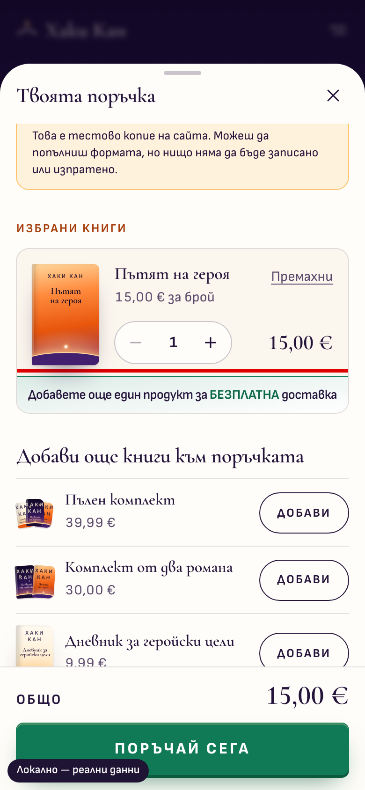
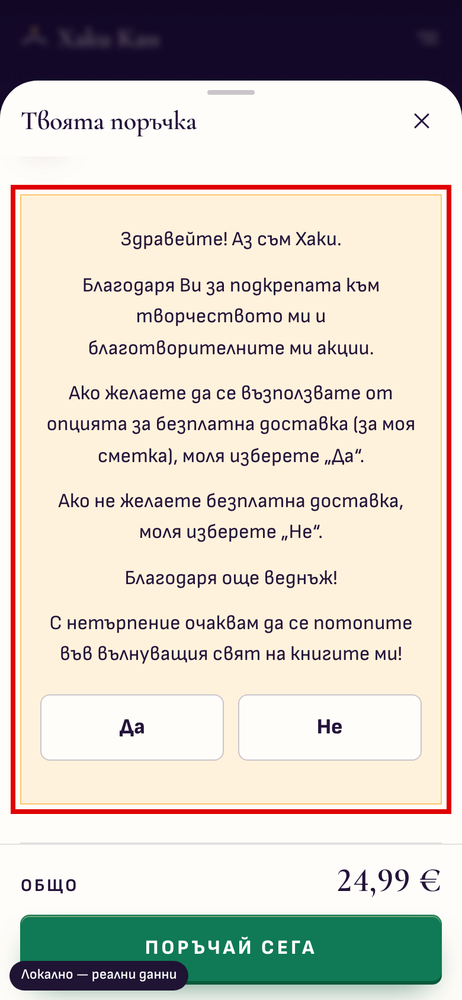
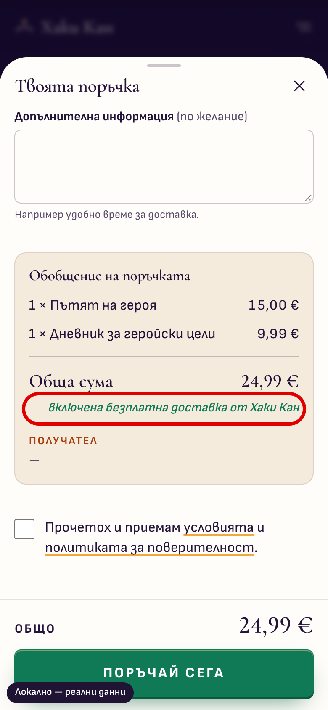
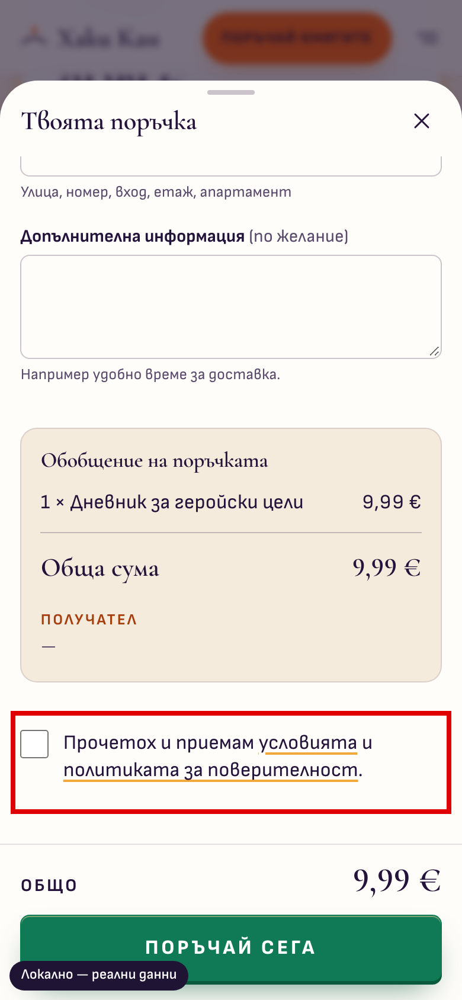
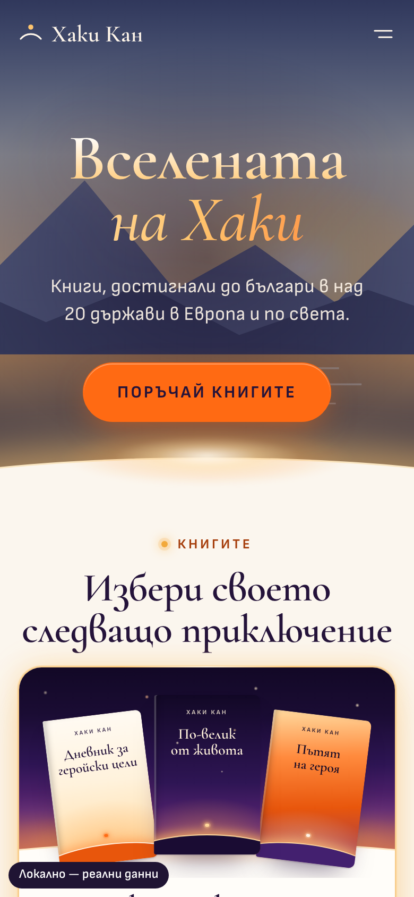
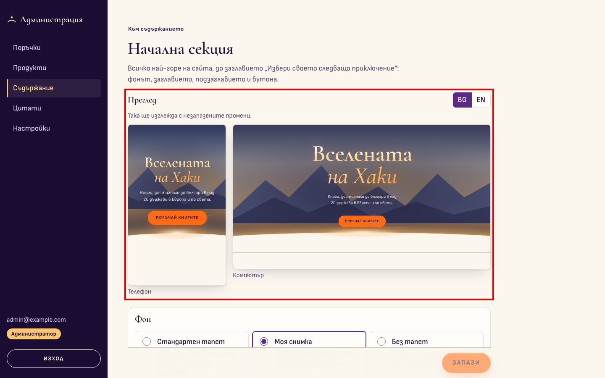
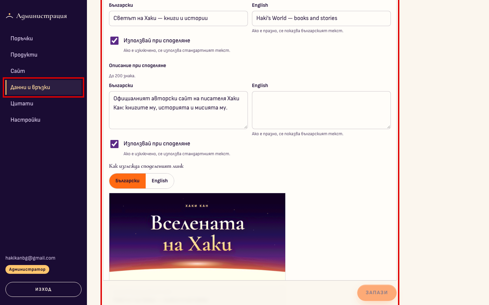
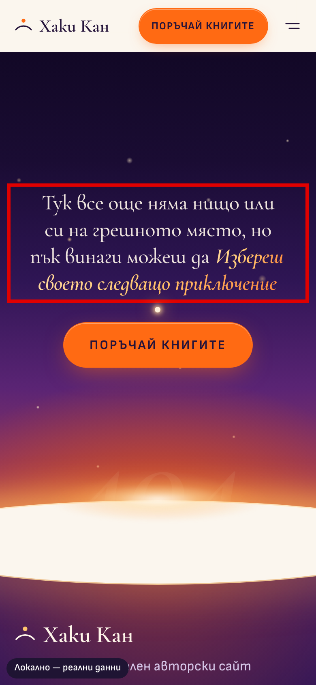

[← Всички издания](../)

# Какво е новото — v2026.11.21.1

## 🚚 Безплатна доставка и Спиди по подразбиране (#66)
„Офис на Спиди“ е избран по подразбиране. При една книга под нея се показва „Добавете още един продукт за **БЕЗПЛАТНА** доставка“. При 2+ книги Хаки пита „Да/Не“ за безплатна доставка; изборът се вижда в резюмето, в админа и в имейла. Текстът на Хаки се редактира от **Админ → Сайт**.

  

## 🤖 Поръчка без CAPTCHA (#63)
Клиентът вече не потвърждава, че е човек. Защитата от спам работи невидимо (минимално време за попълване, скрито поле, ограничение на заявките). CAPTCHA може да се върне с една настройка.

## 📚 Книгите — две еднакви клетки на ред (#64)
На компютър всички книги са с еднакъв размер, по две на ред; „Пълен комплект“ е първи и със златисто сияние. По-малко празно място над книгите и над „Вселената на Хаки“ на телефон.

## 🌅 Начална секция с редактиране (#70)
Нов пункт **„Начална секция“** в админа: стандартният тапет със звездите, собствена снимка или без тапет; редактируеми заглавие, подзаглавие и бутон; превключвател за скриване на текстовете; „Върни стандартния вид“. На телефон менюто има бутон „Още“.

 

## 🔗 Снимка при споделяне във Facebook (#65)
**Админ → Данни и връзки → Споделяне във Facebook и другаде**: качване и изрязване на снимка 1200×630 и жив преглед на картата. „Съдържание“ се казва вече **„Сайт“**.

## 🌌 Страница 404 (#58)
Грешен адрес води към „…винаги можеш да *Избереш своето следващо приключение*“ и бутон към книгите. Изречението се редактира от **Админ → Сайт → Страница 404**.

## 🛠 Зад кулисите
- Регистър на грешките в Better Stack, без лични данни (#54).
- Черновите на правните текстове са отделни файлове за юриста (#56).
- Снимки към всяка промяна и бележки към всяко издание (#68).
