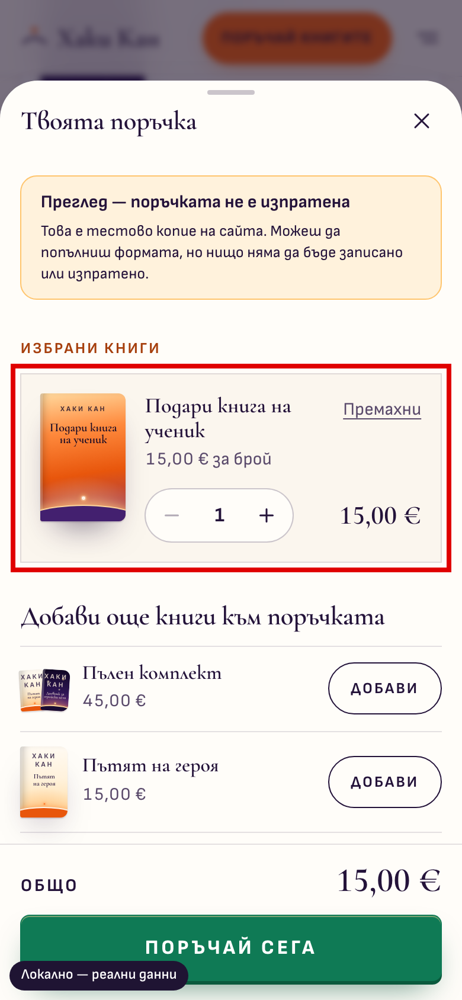
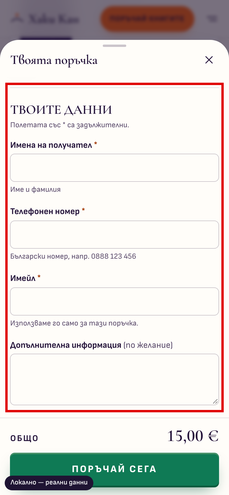
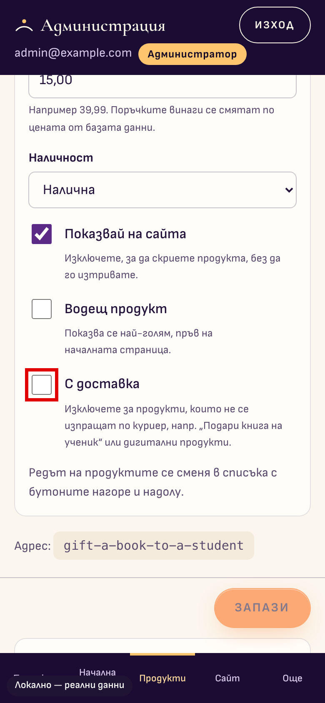
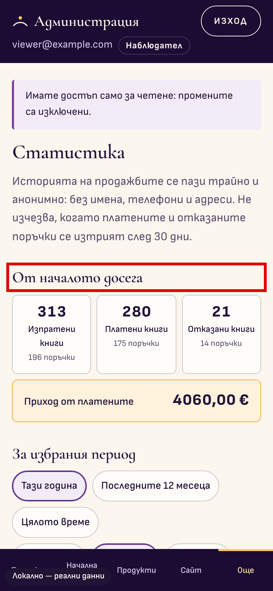
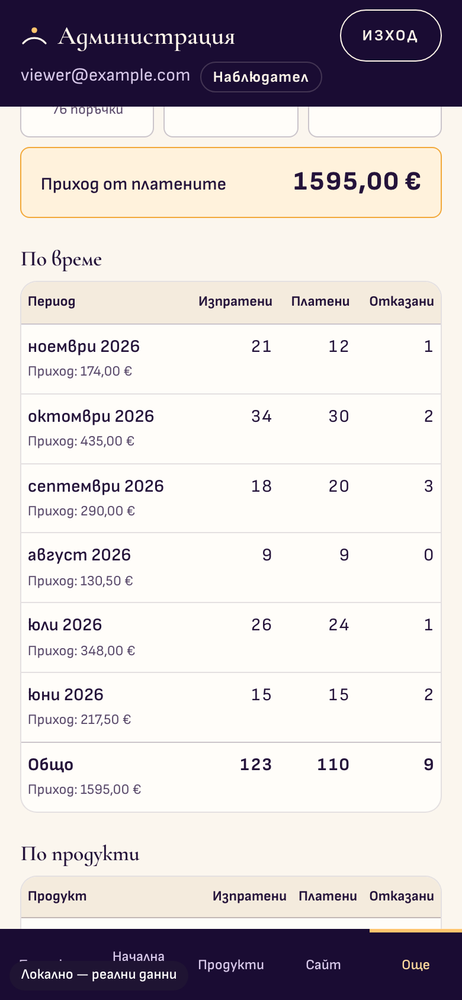
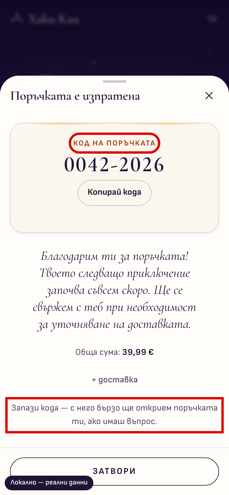

[← Всички издания](../)

# Какво е новото — v2026.11.21.2

## 🎁 Продукти без доставка (#80)
Продукт вече може да е **без доставка** — като „Подари книга на ученик“ (а по-късно и дигитални продукти). Когато в количката има само такива продукти, формата не пита за град и адрес, няма надпис за **БЕЗПЛАТНА** доставка и въпрос „Да/Не“, а в резюмето пише „без доставка“. Настройва се с отметката „С доставка“ в **Админ → Продукти**.

**Важно:** махнете отметката „С доставка“ на „Подари книга на ученик“.

  

## 📊 Статистика на продажбите (#79)
Нов раздел **Админ → Статистика** (на телефон е под „Още“). Броят на изпратените, платените и отказаните книги и приходът вече не се губят, когато поръчките се изтрият след 30 дни. Вижда се всичко от началото, за избран период, по седмици, месеци или години, по продукти и по вид доставка. Пазят се само анонимни данни — без имена, телефони и адреси. Числата на снимките са примерни.

 

## 🔖 „Код на поръчката“ (#78)
След успешна поръчка клиентът вижда **„Код на поръчката“** и по-лек текст: „Запази кода — с него бързо ще открием поръчката ти, ако имаш въпрос.“ Същото пише и в имейла до клиента. В админа и в имейла до Хаки остава „номер“.

## 🛡️ Проверка преди старта (#72)
Сайтът е по-защитен (не може да се вгражда в чужди страници, плюс други защитни настройки) и се отваря по-бързо — около 50 KB по-малко при първото зареждане. На телефон значката „Powered by Netlify“ вече не закрива бутоните „ПОРЪЧАЙ СЕГА“ и „ПРИЕМАМ“. Проверена е и достъпността на основните страници.

## 📰 Бележките по версиите — и на публична страница (#74)
Тези бележки вече имат и страница, която се отваря без достъп до GitHub: https://hakistranica.github.io/release-notes/
